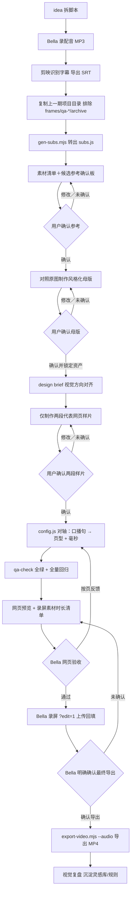

# HTML 动画视频 · 模板化创作工作流

> 一句话定位：**动画视频 = 一次开发 + 每期换配置**。传统路径要动画师、剪辑师、逐秒手调；这套路径把动画做进 HTML/CSS 时间轴引擎，每期新视频的全部成本收敛为：一期配音 + 一份 SRT + 一个 config.js。

## 〇、启动铁律（2026-09-30 Bella 定死，最高优先级，任何视频需求开工前必想清楚）

0. **每次启动先检查远端更新（2026-11-06 用户确认）**：读取本 skill 后、开始任何制作或修改前，在本 skill 目录执行 `node scripts/check-skill-update.mjs`。脚本对比 `skill-version.json` 的本地提交与远端 `main`。仅当返回 `updateAvailable: true` 时，必须调用 `AskUserQuestion` 提醒“远端技能有更新”，询问“先更新 skill 再工作”还是“暂不更新，继续本期”；只有用户明确选择更新后才可更新，更新完成须通过测试并把远端提交写回 `skill-version.json`。用户不更新或未作答则沿用当前版本。`up-to-date` 直接工作；`unavailable` 不阻塞、不骚扰用户，也不把检查失败说成已是最新。严禁未经确认自动覆盖本地技能。
1. **一切视频/剪辑相关需求——引擎方法、平面设计与审美、验收 QA——唯一入口是本 skill。** 开工第一动作：读本 skill + 定位独立开发工程 `~/dev/html-animation-video/`（可用 `HTML_ANIMATION_VIDEO_ROOT` 覆盖）。禁止重写引擎、禁止新建并行工作流/姊妹 skill、禁止「新项目 → 新文件」的任何变体。
2. **引擎只开发一次。** 独立工程包含 `assets/template/player.*` 时间轴播放器、`dev-server.mjs` 静态服务、`scripts/qa_*.py` 关键帧检查和完整 references。每期新增成本 = 配音 + SRT + 场景配置；任何超出「填配置」的新开发，必须先向用户报成本和方案，确认后才动手。
3. **skill 覆盖不了的部分，先对齐再开发。** 不存在「默认动作」「肌肉记忆」——跳过 SOP 从来不是一个可选项（2026-09-30 中网项目根因：绕开本 skill 从零重写引擎，把已付过的成本重新付了一遍，还附赠一遍新 bug）。
4. **交付的完成定义**：qa-check 机器检查全绿 + 全片逐页三帧 contact sheet 贴给 Bella 过目，她点头才算完成。详见 `references/qa-delivery.md`。AI 是执行者兼自检者，Bella 是唯一验收者。
5. **网页预览与最终导出硬边界（2026-10-29 用户定死）**：所有样片、阶段性验收、风格确认、分镜确认、修改复查和全片预览一律使用网页（`serve.command` + `index.html`，可用 `?edit=1`），不得以「样片」「试看」「确认方向」为由导出 MP4 或视频片段。`qa-check` 抽帧与 contact sheet 只用于质量检查，不作为视频预览。只有用户对最终完整网页版本明确说「确认导出／定稿导出」后，才可执行导出命令；此前的「OK／继续／按这版做」只表示进入下一步，不等于授权导出。导出后抽帧复检再交付。
6. 2026-09-30 中网项目血泪沉淀（每条都是交付事故的直接产物）：素材 fit 策略逐页配置、禁止全局 cover 硬裁；字幕逐页定位、禁止全局写死；水印/角标只在设计卡页；内容占比逐页查、禁止死黑空页；contact sheet 必附。
7. **品牌标识与符号红线（2026-10-29 用户定死）**：严禁用星形、多边形、圆形等基础几何拼装去模仿或替代任何品牌 Logo，也严禁把这类简陋符号当作高级视觉主体。需要品牌标识时只能使用来源可靠、比例正确的官方或授权矢量素材；拿不到就使用经过设计的纯文字标识，或与不特定品牌绑定的抽象结构，绝不在 SVG／CSS／Canvas 里手绘近似 Logo。装饰符号必须服务叙事，不能用来填空白。
8. **素材资产双确认闸门（2026-10-29 用户定死）**：脚本拆解后、任何具象素材绘制／风格化／分镜开发前，先整理人物、品牌、物品、场景等素材清单并联网搜集候选参考，制作素材确认板，然后**主动询问用户选择／确认**；用户未明确确认时必须暂停等待，不得默认通过、不得静默继续。参考确认后，对照原图制作风格化母版并再次主动请用户确认；只有确认后的母版及合规变体才能作为资产复用。流程与档案规范见 `references/asset-pipeline.md`。
9. **统一轮廓点阵风格（2026-10-29 用户确认方向）**：人物母版默认只提取头肩／身体外轮廓，内部使用由坐标或随机种子生成的点阵与粒子，**不得读取源图亮度、色彩或内部边缘来重建五官，不得保留可辨认面部**；品牌母版只在已确认的真实矢量路径内做点阵填充与描边，原始路径、比例和比例关系不得改变，生成后必须校验路径数据一致。实名节点和抽象机制可复用同一坐标点阵语言。详细制作与 QA 规则见 `references/asset-pipeline.md`。
10. **两段代表样片闸门（2026-10-29 用户定死）**：母版锁定后不得直接生成全片。先选两段代表场景制作网页样片——优先一段人物／品牌／视觉开场＋一段核心机制／高潮——完成配音、字幕、动效和关键帧 QA 后主动请用户确认。用户未明确确认这两段前，其余段落必须保持未制作；确认后才能沿用锁定资产与已验证动效语言铺开全片。普通“继续”不等于通过样片确认。
11. **重要名词与通用人物前置（2026-10-29 用户定死）**：第一次资产确认前先扫描文稿，把影响理解、反复出现或承担叙事动作的重要名词列成“名词 → 语义资产”清单，并优先为它们设计可复用造型；不得等到分镜阶段再统一退化成文字卡片。公司、机构、人物、董事、投票等优先使用楼宇、机构建筑、无脸人物、座椅、票箱等可辨识资产；股票、合同、权利凭证保留凭证形态。同期必须建立一个通用无脸点阵人物母版，至少包含中立站立与举手投票两种状态，后续股东、员工、投票者只通过颜色、编号、姿态和组合派生，不得逐镜头重画人物。真实人物仍须单独确认肖像参考；通用人物不得冒充特定真人。详见 `references/asset-pipeline.md`。
12. **角色动作按镜头生成（2026-11-03 用户确认）**：通用模板只沉淀角色朝向规则、参数化生成能力与 QA，不预建八方向或全动作帧库。分镜确认后按本期实际镜头生成最小资产集，存入本期工程；角色移动朝向应与路径一致，先转身再起步，不得旋转或翻转单张 PNG 冒充新视角。2.5D 预渲染不等于在播放器中引入全 3D 运行时。详见 `references/asset-pipeline.md`。
13. **输入收集走设计台，禁止对话逐项询问（2026-11-06 定死）**：收到视频需求时按入口双轨分流——用户消息含「请处理 Cheese Motion Agent 任务 motion-…」时走 `references/agent-workflow.md` 交接，读取 `job.json` 与附件拆解回写；不含任务提示时，Agent 必须先启动设计台服务（探测 `http://127.0.0.1:7100/` 是否已在服务本工程，未运行则 `npm run dev -- --host 127.0.0.1 --port 7100`，端口被其他目录占用则换端口），把设计台 URL 发给用户，请用户在页面一次性提交输入整包，SRT 必需、脚本／配音／截图／画幅可选。不得用 `AskUserQuestion` 逐项收集 SRT、脚本、配音或风格偏好——`AskUserQuestion` 只用于远端更新提醒、素材参考与母版确认、样片确认等既有闸门。输入整包未在设计台提交前不进入拆解。

## 〇之二、画面叙事关卡（2026-10-20 Bella 拍桌后新增，**最高优先级，动手前必过**）

> 事故原型：一期报告解读被判「跟文章没区别」——SRT 切段 → 每段套页型 → 填关键词和数字，画面只是好看的版式，观众实际在读字幕。加入场动画后仍是「会动的 PPT」。根因不是缺动画，是**画面没有被当成叙事主体**。

**开工前三问（答不出任何一问，不许动手）：**

1. **这段里正在发生的变化是什么？必须能说出一个动词**（越过／消失／堵住／反转／堆积／被抽走）。说不出动词 = 画面没戏，回去重想。
2. **关掉字幕，观众看得懂这段吗？**看不懂 = 画面只是版式，打回重做。
3. **这一页的产出单位是「页面」还是「动作」？**答案落在「页面／版式／图表」上，直接判退化。

**画面表达优先级的正确顺序**：先问这段内容里**哪个动作值得看** → 再想这个动作的运动长什么样 → 最后才是排版和配色。数字只是结果的标注，不是画面的内容。

**两级设计卡（写代码前必须完成）**：先按语义段落写 `视觉母结构 → 形态轨迹 → 起止时间 → 跨句承接 → 静止帧语义`，再逐句写 `旁白 → 观众应看懂的关系 → 本句推进动作 → 声音 cue`。一个视觉机制承载一个语义段落，可以跨越多个句子；换句子只推进动作，换语义才改变主结构。不得一句一镜，也不得让同一母版或构图换标题后静止撑过多句。参考资产只是识别元素，不是整段画面的答案。详见 `references/semantic-scenes.md`。

**镜界承接硬规则（2026-11-06 连续机制返工沉淀）**：优先让同一视觉母结构跨句存活，通过位移、缩放、路径或形状变形完成因果衔接，例如“能力点 → 共同前沿线 → 成本仪表 → 技术雷达 → 用户轨道”。持续主体必须保持同一 DOM／场景身份，交接前后位置、尺寸与速度连续；但保留 DOM 只是技术底线，主结构或主体关系没有实际演化仍判为静态页。禁止用绿色闪屏、全屏 wipe、白闪或遮罩盖住硬切；换颜色或换遮罩形状不算修复。承接背景置于场景层之下，原对象在窗口内隐藏、窗口外恢复，不得双影；先验证一段完整视觉机制及其跨句演化，用户认可方向后再扩展。

**惯性红线（开工前逐条自查，2026-10-20 三条真实退化路径）：**

| 惯性 | 表现 | 反制 |
|---|---|---|
| 把页型库当解题模板 | 拿到一段内容先想「套哪个页型」，套完就算设计完了 | 页型只能当素材，不能当答案；先写动作再选/造页型 |
| 目标定得太低 | 任务是「出样片验证皮肤」，于是真的只做到皮肤＋版式就停 | 目标必须写到叙事层：「这段要让人看见什么」 |
| 数据类 = 图表 | 报告解读默认做成图表，图表是**结论的静态展示**，要观众自己读懂数字 | 视频演示**过程**：两条线竞速越过、工位逐个熄灯、队列堵在人这里 |

**画面脚本前置**：出片前先交逐段「画面演什么」（动作 + 时长 + 对应字幕），Bella 审过才动手。这条 SOP 原来只在素材环节执行，现在同样适用于画面叙事环节。

**完片自检两条硬指标**：①静音看一遍能不能看懂在讲什么；②每段是否至少有一个「值得看的动作」，没有的那段就是废镜头。

## 〇之三、连续舞台主路径（2026-11-06 合并定稿）

**单舞台＋视觉母结构＋逐句推进动作＋跨句演化，是连续叙事的默认实现路径。** 页型配置继续服务独立页面与 Cheese Motion 契约；需要跨句连续动作时使用 `templates/engine.js` 与 `templates/segment.html`，不得把连续镜头退化为逐句幻灯片，也不得另建平行工作流。

1. 全片只建一个 SVG 舞台和一台摄像机；元素使用带交叠时间窗的 Sprite。相邻承接窗口通常交叠 0.2–0.5 秒，对象在重叠区位移、缩放、重排或变形。
2. 一个视觉机制承载一个语义段落，可以跨多句；句子之间只推进动作，段落之间才改变主结构。母结构、形态轨迹、持续时段与静止帧语义必须先于代码确定。
3. 持续主体跨章节保持同一 DOM／场景身份，但技术连续不等于视觉连续；主结构或主体关系必须随语义真实演化。参考资产只是识别元素，品牌仍遵守官方路径与比例。
4. `render(t)` 必须是纯函数，任意 seek、倒退与逐帧导出结果一致。有音频时预览用音频主时钟；无 SRT 时不伪造精确对轴。
5. 开头约 10 秒验证可作为连续舞台附加样片，但不能替代“视觉开场＋核心机制”两段代表样片；每段样片必须验证完整跨句机制，不是只验证皮肤。所有素材与导出闸门原样保留。
6. `morphRect / zoomThrough / hop / gather / emit / scatter / unroll / bend / retract` 均由引擎真实提供。2.5D 深度轨道与透视投影用于纵深，不能宣称是 WebGL 真 3D。
7. 深色科技 HUD 只是可替换皮肤。默认模板使用 token 化布局，配色、字体、网格、粒子、扫描线与 HUD 都可替换；换 token 不得改叙事代码。

连续制作与完整工具说明：

- `references/semantic-scenes.md` —— 视觉母结构、跨句机制、正反例与样片验证单位
- `references/continuous-workflow.md` —— 字幕纠错、机制段、形态链、分段首帧复原、补丁协议与授权后导出
- `references/script-storyboard.md` —— 逐句推进动作、语义设计、章节与承接规划
- `references/stage-layout.md` —— 画布、安全区、组件、六层、密度、token 与 2.5D 边界
- `references/motion-carry.md` —— Stage／Sprite／Carry helpers、时长、音频主时钟与摄像机
- `references/figures.md` —— 参数化人物、动作、手部跟随、交接与遮挡
- `references/data-viz.md` —— 数据诚信、派生计算、原图证据卡与拆解
- `references/continuous-qa.md` —— seek、身份、交叠、分段连续性、性能与已知坑
- `templates/engine.js`、`templates/segment.html`、`templates/storyboard.md` —— 连续舞台通用实现
- `scripts/srt2subs.js`、`scripts/export.js`、`scripts/concat.sh` —— 字幕与最终授权导出工具

## 一、创作理念（这套东西为什么成立）

三个技术决策撑起整个杠杆，动任何一个都会塌：

1. **时间轴驱动，不是事件驱动。** 所有页面状态由 `seekTo(ms)` 确定性控制，不用 @keyframes 一次性播放。这保证任意时刻可以精确定格——这是逐帧导出成片的前提。
   **动画实现的硬分界（2026-10-20 血泪修正）**：
   - **连续量（条宽／数字滚动／位移／缩放／扫光相位）必须由 `seek(t)` 直接算出来写进 inline style**；
   - CSS `transition` 两态（`.on` 类切换）只承担预览期的观感，**不能承载成片动画**——逐帧导出时 `body.instant` 会 `transition:none !important` 禁掉一切过渡，靠 transition 的动画在成片里会全部退化成硬切，表现就是「成片没有动画」。
   - 新页型上线流程：先用 CDP 按 `?t=ms&export=1` 实况截图验证三五个时刻，**确认成片帧里有动画**，再跑导出。
2. **数据与引擎分离。** `config.js` 描述「第几页、什么页型、什么文案、第几毫秒出现」；`player.js` 只认数据渲染。换一期视频 = 重写 config，引擎零改动。
3. **字幕层独立。** 字幕由 SRT 自动生成（`subs.js`），不进画面层。画面文字只做关键词和金句——这是内容规则（见第五节），也是省成本的关键：口播的完整句子不需要在画面里再做一遍。

与传统制作的真实对比（两期实测）：

| | 传统路径 | 本工作流 |
|---|---|---|
| 动画制作 | 动画师逐秒手调，按秒计费 | 第一期开发约两天，之后零成本 |
| 每期新视频 | 重新剪辑 + 重新做动效 | 配音 + SRT + config 对轴，约半天 |
| 修改轮次 | 回剪辑软件逐处改 | 改 config 一行，重跑导出 |
| 复用性 | 无 | 页型库跨期累积，越用越快 |

## 二、全流程 SOP（每期视频怎么跑）

逐步规则（编号对应图）：

**A · 拆脚本**：先定叙事骨架再写字。科技号产品版范式：痛点压缩 30 秒内 → 产品机制（板块/动线/设计意图）占主体 → 成稿收尾。字数对时长：约 800 字 ≈ 2 分半；行业观察/报告解读类密度更高，1500~1700 字 ≈ 5~6 分钟（中文旁白按 280~300 字/分钟估）。脚本终稿在对话里交付，不落盘。

**A 的改写规则（长稿 → 旁白，2026-10-20 沉淀）**：①骨架沿用原稿分段，不动叙事顺序；②并列的注意事项/限定条件从 N 条压到 3~4 条最要命的，视频里念清单会掉节奏；③所有数字改成中文口语读法（二〇二六、百分之二十一、六倍），让配音不用临场换算；④结尾挑一组对比数字做 punch，不要总结式收尾。

**B–C · 输入契约（2026-11-06 用户确认）**：**SRT 是唯一必需输入**，用于搭建时间轴与叙事骨架；MP3／M4A 等配音和文字脚本均可选。只有 SRT 时直接逐句拆解并制作无声网页预览，不要求用户补脚本或配音；有脚本时用于辅助语义理解和转写纠错，有音频时核对实际路径、时长与浏览器加载／播放，并接入音频主时钟。不要尝试 ASR 对轴；没有 SRT 时引导用户到设计台提交整包（见 〇-13），不在对话里逐个索要，也不用脚本或音频伪造精确时间戳。

**D · 复制模板**：冷启动复制 `~/dev/html-animation-video/` 独立工程，排除 `qa/`、`frames/`、`.git/` 和示例 MP3；沿用其中的播放器、服务、资产流程与 QA 脚本。复制后替换 `subs.js`、配音和场景配置，并修改 `index.html` 标题。**禁止手写新引擎文件。**

**E · 字幕转换**：`node tools/gen-subs.mjs "配音.srt"`。规则：转写错字修正表、相邻句间隔 ≤350ms 且合并后 ≤16 字则并句、尾部延长 100ms。每期把新发现的转写错字补进 FIX 表。

**Cheese Motion 页面交接（2026-11-03 用户确认）**：输入整包仍通过设计台提交；页面生成任务提示后，用户回当前对话发送一次，Agent 读取 `job.json` 与附件，真实拆解分镜、重要名词、品牌和其他素材需求并回写 `analysis.json`。不得用固定词表或预填分镜冒充 AI，不得要求用户预先补品牌。页面只负责展示与三次确认，具体契约见 `references/agent-workflow.md`。

**A0–A3 · 素材资产双确认（强制主动询问）**：先扫描文稿完成重要名词清单与通用人物需求，再整理素材需求；真实人物、品牌、实物和真实场景联网找候选参考，通用语义资产展示设计方向并注明“不指向特定真实对象”。联网检索采用“Bing 国内图片＋Wikimedia Commons”双源融合，品牌检索同时携带英文名与精简中文名，不再只依赖 Wikimedia SVG；所有候选仍须核验来源与授权。确认板必须把重要名词和通用人物排在前面，主动问用户选哪项、是否确认；未明确确认就暂停。参考确认后，制作真实参考的风格化母版，以及通用人物、公司、机构、投票等语义母版和必要变体，再次主动请用户确认；确认后才锁定资产、生成分镜。任何具象素材都不得越过这两道闸门。完整模板、授权记录、目录和资产状态见 `references/asset-pipeline.md`。

**F0 · 设计定稿（新视觉必须前置对齐）**：涉及新视觉方向时，动代码前先出 design brief——参考物 3~5 个、色板、字体角色、贴纸语言、动效性格、视觉母结构、形态轨迹、持续时段、跨句承接、静止帧语义和金句位，和 Bella 对齐后才写 config。改 moodboard 比改一千行 CSS 便宜。模板与格式见 `references/design-aesthetic.md` 与 `references/semantic-scenes.md`。纯复用已定稿视觉的期数可跳过皮肤对齐，但不能跳过机制设计；素材资产双确认不能跳过。

**F · 对轴（每期核心人工成本）**：
- 先把口播按语义组成视觉机制段，写清母结构、形态轨迹和跨句承接；独立页型才按语义切成页（速查见 `references/page-types.md`）
- 每句字幕与动作 cue 对齐；同一机制跨句时保持主结构，只推进变形、重排或主体关系，不要求每句换场
- 独立页 `duration` = 口播段结束戳 − 起始戳；页内 `timing` 全部是**相对本页的毫秒偏移**（SRT 绝对时间 − 本页起始时间）；连续舞台使用全片绝对秒数
- 总时长 = 末条 SRT 结束戳，写进 `meta.total`
- 音效事件 `SFX_EVENTS` 用**绝对毫秒**
- 铁律：每个 timing 值必须 < 本页 duration（印章超页长导致永不出现的 bug 踩过）
- **对轴完先过「设计阶段自查三条」（见第五节）再进 QA**：视觉机制按语义组织／逐句动作与语音同步／画面有信息增量不复读——任何一条不过先回炉，不往下走

**G · QA + 全量回归**：改动越多回归越深。先按 `references/regression-qa.md` 定改动级别（L1 纯数据 / L2 样式页型 / L3 引擎导出），再跑对应深度的检查——`qa-check.mjs` 全绿只是底线，L2 以上必须全页抽帧目检（查遮挡/溢出/样式污染），交付前过一遍人工清单（音画同步、说到哪演到哪、内容规则、录屏槽核对）。**AI 自己跑完全部回归再交付，用户是验收者不是 QA。**

**H · 网页交付与预览**：起 `serve.command` 本地网页预览，所有样片、阶段稿和全片验收都只交付网页链接，不交付预览 MP4。交付物必须包含**录屏素材时长清单**——每个媒体槽需要多长的录屏（按 timing.media 到页尾精确计算），Bella 录素材靠这个对表。这是她的明确要求，漏了就是返工。

**J · 录屏回填**：Bella 在 `?edit=1` 模式点开媒体槽上传，存 IndexedDB 刷新不丢。每段录屏建议多录 1～2 秒余量。

**K · 最终导出闸门**：只有 Bella 对最终完整网页版本明确说「确认导出／定稿导出」后，才执行 `node export-video.mjs --audio`；普通确认、继续制作或风格认可不触发导出。导出前确认音频路径指向本期配音，导出后抽帧复检再交付。

**L · 视觉复盘（5 分钟，每期收尾）**：本期最好看的 3 页 / 最丑的 2 页，各一句话为什么。被批的同类型问题连续出现就升格为规则，被夸的模式抽成新页型/新 token，都追加进 `references/design-aesthetic.md` 的复盘记录。这是审美从 70 分往上走的唯一通道——让每期的判断累积，而不是流走。

**一次喂包原则**（Bella 明确的成本归属修正）：理想节奏是 Bella 把「SRT + 录屏 + 脚本大纲」一次性给齐，AI 跑完整个装配链路后交一版可审核的完整稿——而不是每一步都来回确认。装配过程 AI 自己消化，只在验收节点出现。

## 三、架构分层（哪些复用，哪些每期新增）

| 层 | 文件 | 每期成本 | 说明 |
|---|---|---|---|
| 引擎层 | `player.js`（833 行） | **零改动** | 时间轴引擎 + 全部页型渲染器 + 音效触发 |
| 视觉层 | `theme.css`（1087 行） | 零改动～微调 | 页型样式 + 变体（`.n4`／`.m-page--9x16` 等）；新页型才追加 |
| **设计层** | design brief + design token + 素材库 | **待建设（当前最短板）** | 视觉定稿流程、token 化、SVG 贴纸库——决定这套模板能到 80 分还是停在 70 分，见 `references/design-aesthetic.md` |
| 回归层 | qa-check + 回归清单 | 每轮改动必跑 | L1/L2/L3 分级回归，见 `references/regression-qa.md` |
| 导出层 | `export-video.mjs`（290 行） | 改 3 处路径 | 音频路径／duration 默认值／输出文件名 |
| 质检层 | `qa-check.mjs`（206 行） | 零改动 | 时长期望值动态读 SRT，已自动化 |
| 编辑层 | `editor.js` + `index.html` | 改 title 和 voRange | 页面内改文案／传录屏／调时长 |
| **数据层** | `config.js`（262 行） | **全部重写** | 页型编排 + 毫秒对轴，每期核心工作 |
| 数据层 | `subs.js` | 自动生成 | gen-subs.mjs 产出 |
| 内容层 | 配音 MP3 + SRT + 录屏 | Bella 产出 | 唯一需要人肉准备的东西 |

引擎升级路线（跨期累积，不要每期重做）：MediaSlot 组件化（`normalizeSlot()/slotHtml()/bindSlotMedia()`，aspect 可配 16:9／1:1／9:16，`fit:"auto"` 自动检测并裁掉录屏软件强塞的内部黑边）、`tagColor` 数据驱动配色、`SFX_EVENTS` 预览与导出共享一张表。**新页型开发完必须反哺进页型库**，这是复利所在。

录屏比例适配规则：尽量直接录与槽同比例的素材（9:16 竖屏录手机 APP 界面）。若录屏软件把 1:1 桌面强制成 9:16 并在视频内塞黑边，给 slot 加 `fit:"pad"` 即可用同色背景把黑边「吃」掉，不改变 9:16 播放器框。

## 四、协作铁律（血泪教训，最高优先级）

1. **新视频需求的第一反应是套模板，不是重新发明。** 曾经犯错：拿到新配音去做「视频分镜脚本」，被批——开发模板的全部意义就是换文案换时间戳直接出片。
2. **关键节点先对齐预期再开工。** 涉及新视觉／新页型／结构调整，先给方案（最好配图）等确认；纯装配（复制目录、gen-subs）直接做。
3. **被纠正后先复述正确理解，再动。** 禁止被纠正后立刻闷头重跑。
4. **用户是验收者不是 QA。** 交付前自查到全绿，交付时附 QA 摘要。
5. **少量帧只用于定风格，完整跨句机制才用于定叙事，确认后再铺开**；改动视觉先在网页中定位到 <15s 的对应时间段确认方向，不导出视频片段。

## 五、内容创作规则（v3 沉淀，长期有效）

**画面信息增量铁律（2026-09-18 升格，严禁触碰）。** 页面文案与字幕严禁高度重合。画面必须做抽象化、标签化、可视化的呈现——每个动效的出现都要有必要性：要么呈现结构／关系／对比／机制，要么提供字幕之外的信息增量。如果这页画面的文字跟字幕一模一样，这页动画就不要做；把字幕抄一遍再打出来（双层字幕）是严禁出现的动画设计。自查方法：把画面句和字幕并排，删掉画面句后不损失任何新信息 → 该页重做成可视化，或干脆不做。

**画面文字 = 关键词（≤8 字）+ 每期限 2～3 处金句。**
解释性的完整句子一律交给字幕层；画面用贴纸、图形、动效撑节奏。

**音效克制。** 全片只保留关键仪式音（如盖章 stamp.wav 一处）。禁用翻转／打字等高频提示音——「一惊一乍」被明确否决过。

**录屏槽设计。** 竖屏 9:16 槽展示空间要足（宽 ≥700）；纯概念页（如滤镜原理）不设录屏槽，直接做视觉动线动画。**每处录屏的时长必须明确告知用户。**

**音画同步铁律（2026-11-06 连续机制修正）。** 字幕逐句对轴，视觉按语义段落组织；页面或机制边界不再强制对齐 SRT 句边界。每一句先判形式——讲原理/观点/情绪 → 演示真实机制；讲具体功能操作 → 才进录屏。任何「录屏总时长占比」类配额指令都让位于音画同步。稿子每提一个新信息，现有母结构就要按 cue 推进一个对应动作或关系，禁止一句切一页，也禁止拿静态模板撑时间。压底 punch 句禁止逐字复读字幕，要写成提炼后的观点。

**设计阶段自查三条（对轴时的 checklist，任何一条不过就不进入交付）。**
1. **是否按语义设计了视觉机制**——机制表与字幕并排，逐句核对母结构或主体关系怎样推进，不是凭模板顺手铺。
2. **声音和动作是否同步**——动作 cue 落在对应语音上，视觉段落边界落在语义变化处，无字幕抢跑、动作滞后或画面拖尾；页界不必等于句界。
3. **画面是否是字幕和声音的补充**——主体关系可见、有信息增量；不是一模一样复读，也不是只有位移、淡入淡出或环境运动。

**素材参考与风格化铁律（2026-10-29 升级，最高优先级）。** 画面中任何真实、具象的元素——人物、品牌、实物物品、产品界面、工具截图、真实场景——必须先联网搜集参考并主动请用户确认，严禁无参考用 CSS／SVG／Canvas 手绘或 emoji 猜画。可直接使用来源与授权清楚的真实图片，也可对照已确认参考进行抠图、轮廓提取、描边、有限矢量化、配色和纹理风格化；母版完成后再次主动请用户确认，确认后的资产才可复用。风格化不自动消除版权或商标风险，必须记录来源、授权和品牌规范。抽象手绘只承担有叙事功能的抽象与装饰职责。完整流程见 `references/asset-pipeline.md`。

**视觉语言。** 手绘／贴纸／撕纸／胶带／印章体系；禁止直尺式直线色块划线（用 SVG path + stroke-dashoffset 手绘描线代替）；色块不透明度 .92+、饱和度拉满；装饰不压正文。

**槽比例与显示效率**（contain 模式实测，900×1000 槽内）：1:1 最佳（字号可视 83%），16:9 上下黑边 25%，9:16 左右黑边 19%。按录屏内容选，不默认竖屏。

## 六、踩坑索引

两天 17 个坑全部记录在 `references/pitfalls.md`，按「致命级／返工级／协作级」分类。装配新一期前扫一眼致命级，每期都可能再踩。

## 七、优化方向（后续可能性）

**视觉与审美（当前最短板，长期建设）**——现状自评 70 分，第一版的简陋是「没有设计定稿流程」的必然结果，不是意外。建设路线四步，详案见 `references/design-aesthetic.md`：
1. design brief 前置（P0，纯流程零成本，立即生效）
2. design token 化：色板/字号阶梯/动效档位与曲线全部收进 `:root`，新样式禁用魔法数——锁死已有风格，性价比最高的一步
3. SVG 贴纸库 + 质感素材，突破 CSS + emoji 的上限
4. theme 拆 base + skin，多账号皮肤化

**工程与自动化**：
- **回归自动化**：timing 边界检查、画面文字 × 字幕重复度检测、Golden Frames 视觉回归（见 `references/regression-qa.md` 第五节）
- **页型库扩充**：现有 12 个页型（见 `references/page-types.md`），每期新视觉沉淀成新页型，长期形成「科普视频组件库」
- **对轴半自动化**：SRT 句子 → 页型映射给 AI 建议初稿，人只做校对
- **封面配套**：cover-studio.html 已存在（EP 系列封面模板编辑器），与视频模板同体系
- **分发适配**：导出参数化后可出 16:9 横版切片（B 站／YouTube）

## 附：文件索引

- `references/page-types.md` —— 12 个页型的 props/timing 配置速查
- `references/pitfalls.md` —— 全部踩坑记录与修复方案
- `references/commands.md` —— 复制模板/gen-subs/serve/qa/export 命令手册
- `references/regression-qa.md` —— 全量回归清单（L1/L2/L3 分级 + 自动/半自动/人工三层）
- `references/qa-delivery.md` —— **交付前 QA 全流程**（机器八项 + contact sheet + 逐页目测清单 + 历史教训索引；原 html-animation-video-qa skill 已并入，唯一 QA 标准）
- `references/design-aesthetic.md` —— 设计审美层：70 分差距诊断 + 四步建设路线 + 采购清单 + 复盘记录
- `references/cheeseheart-style/README.md` —— **芝士心 · 荧光绿科技**（`cheeseheart-tech`）完整皮肤：近黑底、荧光绿、品红/紫点缀、等宽数据、HUD、构件、动效与样张；选择该风格时必须通读并遵循，仍复用主引擎与全部叙事/确认/导出闸门
- `references/asset-pipeline.md` —— **素材资产定稿与复用流程**（素材清单、候选参考、两道主动确认闸门、风格化母版、变体、授权记录与资产 QA）
- 独立开发工程：`~/dev/html-animation-video/`（唯一引擎与资产流程母本，跨项目复用；可用 `HTML_ANIMATION_VIDEO_ROOT` 覆盖）
- 通用参考实现：`assets/template/`（只含模板与演示数据；具体视频案例、配音、素材和确认产物不进入通用仓库）
