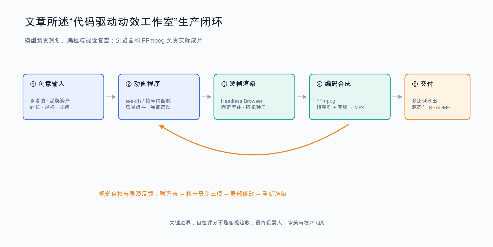
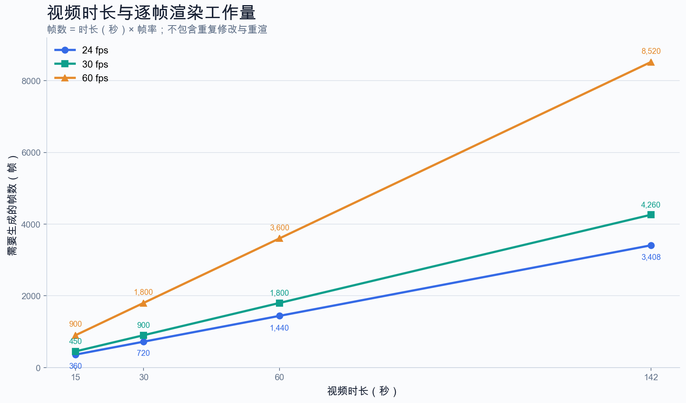

# 《How to build motion design studio with Opus 5.5 (Full-course)》调研报告

**调研日期：2026 年 11 月 2 日**  
**调研对象：Movez（@0xMovez）发布的 12 步代码驱动动效教程**  
**调研方式：原文存档、模型使用指南、框架官方文档、开源仓库与安全资料交叉核验**

## 执行摘要

这篇文章值得读，但更适合被理解为一份**“用编程代理搭建程序动画生产管线”的实践综述**，而不是“输入一句话就能替代动效工作室”的证据。原文由 Movez 于 2026 年 9 月 27 日以 X Article 形式发布，核心主张是“提示词只占 10%，其余 90% 是外围生产框架”。这一比例没有量化实验支撑，但它准确指出了问题的重心：稳定产出不仅取决于提示词，还取决于参考资产、确定性渲染、分镜约束、自动截帧、视觉反馈和可复用工程。[Omnigami](kimi-cite://web?url=https%3A%2F%2Fomnigami.ai%2Fguides&text=How%20to%20build%20motion%20design%20studio%20with%20Opus%205.5%20%28Full-course%29by%20Movez%20%28%400xMovez%29%20%C2%B7%20X%20Article%20%C2%B7%2027%20September%202026 "citation"), [XPut 存档](kimi-cite://web?url=https%3A%2F%2Fxput.app%2FcQDeqX&text=The%20prompt%20is%2010%25%20of%20the%20video.%20The%20other%2090%25%20is%20the%20harness. "citation")

本次调研的结论是：**工程方法可信度高，案例数字证据中等，商业收益论证偏弱。** 最值得采用的是 `seek(t)` 或“帧号到画面”的纯函数模型、先分镜后编码、参考资产驱动、联系表自检、局部修改与多比例布局。最需要保留判断的是“10 分钟安装”“爆款都必须使用 `xhigh/max`”“一个下午即可交付并变现”等表述。文章尤其适合产品发布片、UI morph、动态字体、品牌图形、数据可视化和代码绘制的风格化短片；对真人实拍、复杂物理、长叙事一致性和精细后期，它不是无条件替代方案。

| 维度 | 调研判断 |
|---|---|
| 总体建议 | **有选择性采用，优先复用工程方法，不照搬宣传性结论** |
| 最可靠部分 | 确定性逐帧渲染、参考与规格前置、视觉反馈闭环、源码化交付 |
| 证据较弱部分 | 10/90 比例、固定安装耗时、普遍收入与制作效率、自评 8 分即达标 |
| 最适合 | 产品/UI 动效、动态字体、Logo、图形、数据动画、风格化代码短片 |
| 谨慎使用 | 真人写实、复杂角色表演、长片连续性、重剪辑与精细调色项目 |
| 复现门槛 | 需要终端、Node.js、浏览器、FFmpeg、素材管理与基础技术验收能力 |

## 一、文章定位与内容结构

### 1.1 原文定位：它是一门“生产系统课”

截图对应的文章已定位到公开存档，原帖当前未能直接抓取，因此本报告以存档全文为内容底本，并用其他资料核验其关键说法。文章开头明确指出，很多人得到“渐变背景、居中文字、统一淡入、结尾 Logo”的同质感，原因不是单纯不会写提示词，而是没有提供视觉参考、没有渲染引擎，也没有让模型查看自己的输出帧。它将解决路径拆成 12 个步骤，并汇总了多个早期公开案例与开源仓库。[XPut 存档](kimi-cite://web?url=https%3A%2F%2Fxput.app%2FcQDeqX&text=They%20don%27t%20give%20it%20a%20reference%2C%20don%27t%20give%20it%20a%20render%20engine%2C%20don%27t%20ask%20it%20to%20look%20at%20its%20own%20frames. "citation")

因此，标题中的“studio”首先指一套可重复运行的**制作环境**，其次才涉及服务与收入。若把它当作传统动画工作室创业课程，会高估其商业内容；若把它当作“代理如何进入动效生产”的技术导论，则价值更清晰。文章的优势不是发明了浏览器截帧或 FFmpeg 合成，而是把当时零散的爆款案例整理成一条可讨论的流水线，并明确将人的角色从逐帧操作转向参考选择、分镜审批、反馈和验收。

### 1.2 十二步可以压缩为四层

原文的 12 步看似覆盖提示词、渲染、音乐、技能和商业模式，实际上可以归纳为四层。第一层解释模型写程序而非直接输出视频；第二层把创意意图翻译成参考、品牌资产和逐拍状态；第三层建立确定性画面、运动与声音；第四层通过导演说明、自检、技能封装和多比例导出形成复用。这样的结构比逐条收藏提示词更有迁移价值，因为模型和框架更换后，四层职责仍然存在。

不过，四层并非同等成熟。前两层是可靠的创意管理方法，第三层有官方框架文档与源码支撑，第四层中的“变现”和“一个下午交付”主要是案例叙述。学习时应先把前三层跑通，再讨论服务定价，而不宜从爆款浏览量直接推导稳定收入。

| 层级 | 对应章节 | 解决的问题 | 调研评价 |
|---|---|---|---|
| 认知与环境 | 01–02 | 谁写代码、谁渲染、代理在哪里执行 | 基础且必要 |
| 导演输入 | 03–06 | 一句话、品牌、参考、状态规格如何约束结果 | 对摆脱同质化最有帮助 |
| 动画引擎 | 07–09 | 确定性帧、弹簧运动、节拍与音频 | 全文技术核心 |
| 工作室化 | 10–12 | 长任务、自检、多格式、技能与服务 | 方法有用，商业数字需另证 |

## 二、技术路线与真正可复用的原理

### 2.1 核心不是“AI 视频”，而是“可寻址的程序画面”

文章所述流程是：模型读取文本和图像，生成 HTML、Canvas、SVG、React 或其他代码；无头浏览器按指定时间逐帧绘制并截图；FFmpeg 再把帧序列与音频编码成视频。其关键函数可写成 `frame = seek(t)`：任意时刻 `t` 都能独立得到同一画面，不依赖上一帧是否刚刚运行。Remotion 官方文档也要求动画由当前帧号驱动，并指出渲染可能并行、乱序访问帧，因此组件不应依赖真实时钟、顺序状态或未受控随机数。[Remotion](kimi-cite://web?url=https%3A%2F%2Fwww.remotion.dev%2Fdocs%2Fflickering&text=Think%20of%20your%20component%20as%20a%20function%20that%20transforms%20a%20frame%20number%20into%20an%20image. "citation")

这一原则带来局部重渲、并行渲染、任意跳帧、联系表审查和版本比较等实际收益，但文章对“确定性”的说明还不够完整。真正复现时还要固定随机种子、视口、设备像素比和依赖版本，等待字体与图片加载完成，并避免网络素材在渲染期间变化。否则即使存在 `seek(t)`，仍可能出现字体替换、空白帧、闪烁或跨机器像素差异。[Remotion](kimi-cite://web?url=https%3A%2F%2Fwww.remotion.dev%2Fdocs%2Fflickering&text=Ensure%20you%20correctly%20wait%20for%20fonts%20to%20load. "citation")

### 2.2 自检闭环有效，但不能替代验收

文章把“让 Opus 看自己渲染的帧”视为高质量作品与普通初稿之间的分水岭，这一判断在流程设计上合理：模型可以读取联系表，检查文字裁切、留白、颜色、场景缺失和参考偏离，再修改代码并重渲。相比只让用户用自然语言描述想象中的结果，截帧把反馈变成了可观察证据，也让“只改第三镜”成为可执行操作。它同时符合软件工程中的测试—反馈—修复循环，而非玄学提示词技巧。

但“每帧评分达到 8 分以上”不是客观验收标准。模型自评可能随提示、参考和上下文变化，也不保证能识别节奏拖沓、品牌不匹配、音乐版权、细微闪烁或叙事问题。更稳妥的做法是把模型自检用于发现明显缺陷，再叠加自动技术 QA 与人工审美审批：自动检查黑帧、尺寸、文字溢出、音画同步和首尾循环，人负责判断创意、节奏与品牌是否真正成立。

帧数按“时长 × 帧率”线性增长：15 秒、60 fps 的确是 900 帧，142 秒、60 fps 则为 8,520 帧，而且这还没有计算多轮修改。由此可见，文章提倡的半分辨率预览、低帧率审片、局部重渲和并行渲染不是可有可无的优化，而是长项目控制时间与成本的基本措施。

## 三、关键说法核查

### 3.1 技术与模型相关说法

多数基础技术说法能够成立，但若干经验观察被写得过于绝对。尤其是推理档位：文章称其收集的爆款 one-shot 都使用了 `xhigh` 或 `max`，这只能代表作者样本，不应转化为“新片必须开高档”的规则。公开 prompting 指南的二手报道显示，Opus 5.5 默认 `medium`，更合理的方法是从基线开始，用自有任务比较质量、延迟与成本，只在确有收益时提高档位。[Search Engine Journal](kimi-cite://web?url=https%3A%2F%2Fwww.searchenginejournal.com%2Fanthropic-claude-opus-5-5-prompting-guidance%2F591278%2F&text=Reserve%20xhigh%20and%20max%20for%20work%20where%20you%27ve%20measured%20a%20quality%20gain. "citation")

开源证据也支持保留这一弹性。文章推荐的 `PDoomVideo` 仓库说明，其首轮生成使用的是 Opus 5.5 Medium，并且实际经历了两轮生成，而不是“最高档一次完成”。仓库公开了九个章节、`STORYBOARD.md`、`ANIMATION_GUIDE.md`、逐帧渲染和 FFmpeg 编码脚本，足以证明代码驱动长片管线真实可运行；它同时也证明，优秀作品背后的流程比一句提示词复杂。[PDoomVideo](kimi-cite://web?url=https%3A%2F%2Fgithub.com%2FJohnHeibel%2FPDoomVideo&text=The%20video%20took%20two%20generations%2C%20both%20in%20Claude%20Code%3A "citation")

| 原文说法 | 核查结论 | 应如何理解 |
|---|---|---|
| 模型写程序，外部工具产出 MP4 | **与文章所述 API 工作流一致** | 不应把代码渲染与原生视频生成混为一谈 |
| 15 秒 × 60 fps = 900 帧 | **算术正确** | 尚未计入失败帧与多轮重渲 |
| `seek(t)` 支持确定性和跳帧 | **官方框架文档支持其原理** | 仍需控制字体、随机数、资源和运行环境 |
| 新片使用 `xhigh`，重要开头使用 `max` | **经验建议，不是必要规则** | 先以 `medium` 建基线，再做同题对比 |
| 10 分钟装好工作室 | **条件性最好情况** | 熟悉终端者可能达成，新手排障时间不可预估 |
| 闭式弹簧适合确定性渲染 | **方向正确** | 多次变目标时必须正确处理位移与速度连续性 |

### 3.2 案例与商业相关说法

文章引用的 163 次模型调用、约 6¾ 小时、30 分钟产品片、约 9,500 字符导演说明、浏览量和约 1,000 美元历史报价，大多来自创作者公开帖子或作者转述。它们可以用来说明不同项目的投入差异，却缺乏统一样本、完整账单、人工成本与验收结果，不能据此计算普遍 ROI。特别是“以前值 1,000 美元，现在一个下午交付”只比较了名义价格与表面制作时间，没有比较修改范围、版权、创意深度、客户沟通和责任承担。[XPut 存档](kimi-cite://web?url=https%3A%2F%2Fxput.app%2FcQDeqX&text=Watercolor%20short%2C%20openly%20not%20one-shot%3A%20163%20model%20calls%2C%20about%206%C2%BE%20hours. "citation")

文章关于“10% 提示词、90% 生产框架”的表达也应视为强调性比喻，而非测量结果。它没有定义分母、质量指标或对照实验，因此无法据此推断优化管线一定比优化创意重要九倍。更可靠的解释是：当模型已经能生成基本动画代码后，继续堆砌提示词的边际收益会下降，参考、渲染和反馈机制会成为主要瓶颈；这与文章的实践方向一致，但不需要一个看似精确的比例才能成立。

| 证据类型 | 可支持的结论 | 不能支持的结论 |
|---|---|---|
| 公开源码、分镜、渲染脚本 | 管线确实存在，可研究和复现 | 所有项目都能同样快速、同样美观 |
| 作者公开耗时与调用次数 | 某些案例远非“一键成片” | 行业平均成本与交付周期 |
| 浏览量、书签、星标 | 案例受到关注 | 技术质量、客户价值或利润 |
| 历史机构报价与服务报价 | 存在价格锚点和商业化尝试 | 稳定订单、实际成交与净利润 |
| 模型自评分数 | 可形成内部迭代规则 | 客观、可跨项目比较的质量认证 |

## 四、实际价值、边界与风险

### 4.1 最值得关注的三项价值

第一项价值是**把创意资产变成可维护源码**。传统视频修改往往依赖时间线操作，而代码路线可以把品牌颜色、字体、产品数据、时长和比例参数化，并通过 Git 管理版本。第二项价值是**把审美反馈前置并具体化**：参考图、负面约束、状态列表和分镜审批比“高级一点”“更有质感”更能减少无效生成。第三项价值是**形成可复用反馈回路**：渲染、联系表、自检、局部修复和再次渲染，使结果不再完全取决于首次生成的运气。

这些价值并不专属于 Opus 5.5。换成其他具备代码与视觉能力的代理，或把自建 HTML 换成 Remotion、HyperFrames，原则仍然有效。因此，这篇文章更像一份“代码动效生产范式”的入门材料，而不是某个模型版本的永久操作手册。模型会更新，具体参数会变化，但确定性、可观察性和分阶段审批仍是长期有效的工程资产。

### 4.2 主要边界：不是每种视频都适合代码化

代码驱动路线最适合界面、图形、文字、Logo、二维角色、数据与可程序化视觉效果，因为这些对象能明确描述并稳定重绘。对于写实人物、复杂布料与物理、真实镜头光效、大量既有素材剪辑、精细调色和严格音频后期，专用视频模型或传统剪辑/合成工具仍可能更合适。文章也承认模型“不是摄像机”，但其标题与变现段落仍容易让读者低估不同片种之间的差异。

另一个被低估的问题是安全。教程鼓励代理访问产品 URL、自动收集资产、读取 `.env` 中的 API 密钥并长时间运行；这会引入间接提示注入、恶意技能、依赖漂移和权限过大的风险。`.env` 只是避免把密钥直接贴进提示词，并不构成隔离。OWASP 对代理技能的建议包括最小权限、默认沙箱、外部域名白名单、依赖固定和审计日志，这些应当成为无人值守生成的前置条件。[OWASP](kimi-cite://web?url=https%3A%2F%2Fowasp.org%2Fwww-project-agentic-skills-top-10%2Fast05.html&text=Allowlist%20permitted%20reference%20domains "citation")

| 更适合采用 | 应谨慎或混合采用 |
|---|---|
| 产品发布片、功能演示、UI 状态 morph | 真人写实广告、复杂表演与物理模拟 |
| 动态字体、Logo sting、品牌图形 | 长片角色一致性与复杂叙事 |
| 数据可视化、批量参数化视频 | 大量访谈、纪录片与既有素材精剪 |
| 需要源码、版本控制和自动化的团队 | 只熟悉 After Effects 且交付需可编辑工程的项目 |
| 可人工审批关键闸门的半自动流程 | 持有高权限密钥的完全无人值守流程 |

## 五、采用建议与最小复现方案

### 5.1 不要默认从“全部自建”开始

自建 `index.html + render.mjs` 最适合理解原理、控制依赖和做极短实验；它并不意味着长期维护成本最低。HyperFrames 更偏 HTML/CSS/GSAP 与代理工作流，Remotion 更偏 React 组件、参数化视频和成熟渲染生态。二者都采用确定性帧与浏览器渲染思路，但在 authoring model、许可、组件和云端能力上不同，应按团队已有技能选择，而不是只比较首次安装速度。[Wireflow](kimi-cite://web?url=https%3A%2F%2Fwww.wireflow.ai%2Fblog%2Fhyperframes-vs-remotion&text=HyperFrames%20turns%20plain%20HTML%20into%20MP4%20under%20Apache%202.0%2C%20and%20Remotion%20renders%20React%20under%20its%20own%20license. "citation")

如果团队没有前端经验，可以先做一个小型自建 demo 理解 `seek(t)`，随后用成熟框架完成正式项目；如果已有 React 组件与设计系统，Remotion 通常更自然；如果主要素材本来就是网页，HTML 路线会更直接。若核心需求是写实镜头而非图形动画，则应把生成式视频模型作为素材来源，再用代码框架做排版、合成和批量变体，而不是强行全部用 JavaScript 重画。

| 路线 | 优势 | 代价与风险 | 建议场景 |
|---|---|---|---|
| 自建 HTML + Playwright + FFmpeg | 原理透明、依赖少、可控 | 预览、校验、资源等待和工程维护需自行补齐 | 学习、实验、极简短片 |
| HyperFrames | HTML 优先、代理工作流、无需 React | 生态较新，需核对当前许可与版本 | 网页式动效、快速产品片 |
| Remotion | React 组件化、参数化与渲染生态 | 需要 React 能力，并核对团队许可 | 长期模板、数据驱动和团队协作 |
| 视频模型 + 代码合成 | 写实素材与精确排版可分工 | 工具链更长，素材一致性与授权需管理 | 混合广告、风格化叙事、品牌后期 |

### 5.2 建议的 15 秒最小验证实验

不要从 142 秒音乐片或 overnight 无人值守开始。建议选择一条 15 秒、24 或 30 fps、单品牌、3–5 个镜头的产品动效，先验证流程能否稳定重复，再增加时长与自动化。推理档位以 `medium` 为基线，保留同题 `xhigh` 对照，记录模型调用、人工时间、渲染时间、失败类型与修改轮数。这样得到的是自己的成本曲线，而不是依赖爆款案例估算。

最小实验应包含以下八道闸门：**固定交付规格；准备有授权的参考与品牌资产；只写分镜不写代码；人工确认分镜；实现确定性场景；输出联系表并局部修复；执行自动技术 QA 与人工审美验收；保存源码、提示词、依赖锁和渲染说明。** 首轮成功的标准不是“看起来也能 viral”，而是同一输入可以稳定重渲、修改一个镜头不会影响其他镜头、最终视频在目标平台正常播放。

1. 固定 15 秒、分辨率、帧率、画幅和音频要求。
2. 准备 2–3 张参考图，注明借鉴什么、不借鉴什么。
3. 先生成逐镜分镜与状态表，暂停等待人工确认。
4. 用 `seek(t)` 或当前帧号实现每个独立场景。
5. 固定字体、随机种子、视口和素材版本，等待资源加载。
6. 渲染关键帧联系表，模型自检后再由人工审批。
7. 检查文字溢出、黑帧、闪烁、音画同步、循环首尾与多比例布局。
8. 归档源码、依赖锁、提示词、素材授权和一键渲染说明。

## 六、结论

这篇文章的最大贡献，是把“AI 做动效”从一句提示词重新定义为一套可观察、可修改、可复用的生产系统。其最有价值的建议——参考前置、分镜审批、确定性渲染、视觉自检、局部迭代和源码交付——均具有清晰工程逻辑，并能被官方框架文档或公开源码部分印证。对于希望把 AI 引入产品动效与品牌内容的人，它是一份有启发性的起点。

阅读时应主动削弱其发布初期的传播话术：不要把 10/90 当实验结果，不要把 `xhigh/max` 当质量开关，不要把单个高收入或高浏览案例当商业保证，也不要把模型自评当最终验收。最合理的采用方式是先跑通 15 秒小项目，测量自己的质量和成本，再决定是否把它封装成团队技能或服务产品。
