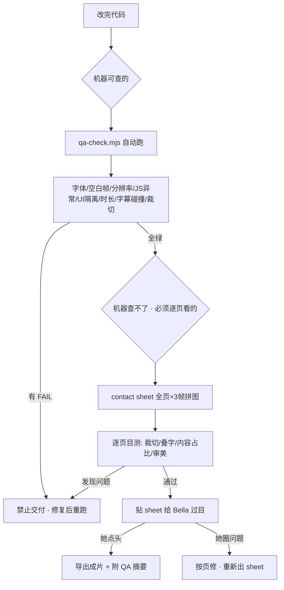

# 交付前 QA · 全流程自查（唯一 QA 标准，持续迭代）

> 铁律：**交付给用户看的每一个 MP4/截图/HTML，必须先过完本清单**。AI 是执行者兼自检者，用户是唯一验收者——不是 QA。
> 交付的完成定义 = 机器六项全绿 + contact sheet 贴给 Bella 过目且她点头。缺一样都不许喊完成。

## 何时触发

- HTML/CSS/JS 时间轴动画 → CDP 逐帧截图 → ffmpeg 合成 MP4 的项目，**每次交付前**
- 交付任何截图、demo 片段、全片导出、HTML 链接之前
- 改了 player / theme / config / 字体相关任何东西之后

## 流程骨架

## 机器检查八项（脚本化，禁手跑）

| # | 检查项 | 怎么查 | 为什么（踩过的坑） |
|---|--------|--------|--------------------|
| 1 | JS 异常 | `Runtime.exceptionThrown` 挂监听再导航 | 引号错配没报错，截图全白 |
| 2 | 字体真实加载 | `document.fonts.check('40px "字体名"')` 必须全 true，否则中止 | **`document.fonts.ready` 在字体加载失败时照样 resolve**——v8 整片黑体就是这么漏出去的 |
| 3 | 导出 UI 隔离 | 页面加 `?export=1` → body.exporting 隐藏一切 UI | 编辑按钮被拍进画面 |
| 4 | 逐页抽帧 | 每页取 入场+60ms / 中点 / 结尾-200ms 三个时间点截图 | 页面级渲染错误只有看帧才知道 |
| 5 | 帧非空白 | PNG > 120KB（空白帧 ~35KB，正常帧 >400KB） | 全白帧一眼漏 |
| 6 | 分辨率 + 总时长 | PNG IHDR 解析宽高 = 1080×1920；总时长 ≈ 配音时长（偏差 <1.5s） | 尺寸错 = 剪映里对不上 |
| 7 | **字幕碰撞**（2026-09-30 新增） | 逐页取字幕区域截图，人工/程序确认字幕不压画面自带文字 | 字幕全局写死 bottom:130px，正面压在证书图文字上，三层糊死 |
| 8 | **素材裁切**（2026-09-30 新增） | 所有 cover/裁切类页面，强制抽帧看「被裁掉了什么」 | 1206×2622 竖屏录屏 cover 硬裁，题干选项全切，文字不可读 |

任一 FAIL → **exit 1，禁止交付**，修完重跑。

## 逐页目测清单（机器替代不了的，必须看帧）

1. **字体字形**：抽帧里的大字必须是目标字体，不能回退黑体（fonts.check 只能证明字体文件加载了，证明不了 CSS 引用链全对）
2. **裁切完整性**：每页看素材边缘——题干/选项/证书文字/标题是否被切（先看素材里什么是必须完整的，再定这页怎么裁）
3. **字幕位置**：逐页看字幕落点处画面有没有自带内容（录屏的 UI 浮层、图片自带的文字），有就逐页挪位
4. **内容占比**：每页有效内容 ≥ 半屏，死黑/空白占大头的段落换素材或重选区间
5. **叠字**：大字、图卡自带文字、底部字幕三层不许互相压
6. **水印/角标**：只在设计卡页显示，录屏页不许压 App 自身 UI
7. **动效语言统一**：直尺线/矩形色块划线禁止，统一手绘/贴纸语言
8. **每页状态在动**：入场帧 ≠ 中段帧 ≠ 结束帧
9. **色块饱和度**：不透明度 .92+，不能寡淡

## 交付纪律

- **先 1-2 张定风格，Bella 确认后再铺开全片**——禁止一次产出 5 张以上未确认风格的图
- 改动任何视觉/动效，先在网页中定位到对应时间段（<15s）确认方向，再动全片；禁止为确认方向导出视频片段
- 字体**必须本地化**（woff2/ttf 放项目 fonts/ + @font-face），禁止交付依赖在线 CDN 字体的版本
- **交付 MP4 必附 contact sheet**（全片逐页 × 3 帧拼图）+ 一句话 QA 摘要（几项全过、抽了几帧）
- 链接交付要同时给：预览地址 + 本地 file:// 路径
- 录屏素材类项目，交付预览必须附**录屏素材时长清单**

## contact-sheet 用法

`~/.workbuddy/video-engine/contact-sheet.py`：输入帧目录，输出全片逐页三帧拼图（带页码/时间戳标注）。每轮交付前自动生成，作为验收物贴给 Bella——她看图 30 秒能圈出的问题，不要让她看完视频才发现。

## 历史教训索引

- 整片字体回退黑体（2026-09-10）：fonts.check 一行就能拦
- 录屏 cover 硬裁切掉题干选项（2026-09-30 中网 v2）：逐页 fit 策略 + 裁切抽帧检查
- 字幕压证书文字三层叠（2026-09-30 中网 v2）：字幕逐页可配位置 + 碰撞检查
- 彩蛋段 60% 死黑（2026-09-30 中网 v2）：内容占比逐页查
- 水印压 App 顶栏（2026-09-30 中网 v2）：水印只在设计卡页
- 绕过已沉淀 SOP 从零重写引擎，重复踩一遍全部坑（2026-09-30 中网项目根因）：启动铁律见 SKILL.md 第〇节
